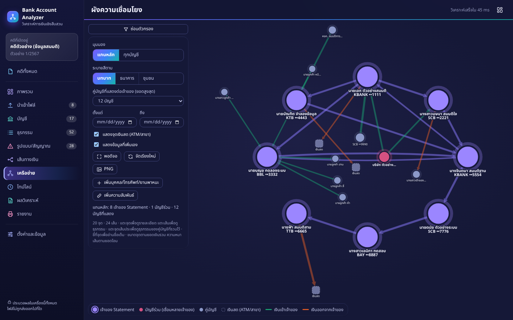
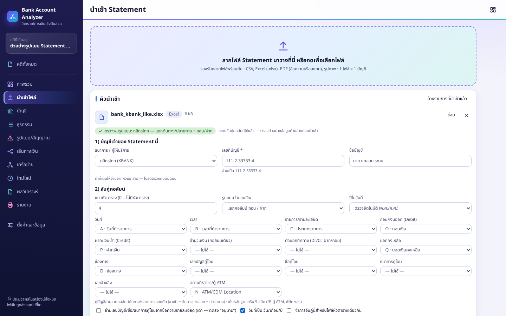
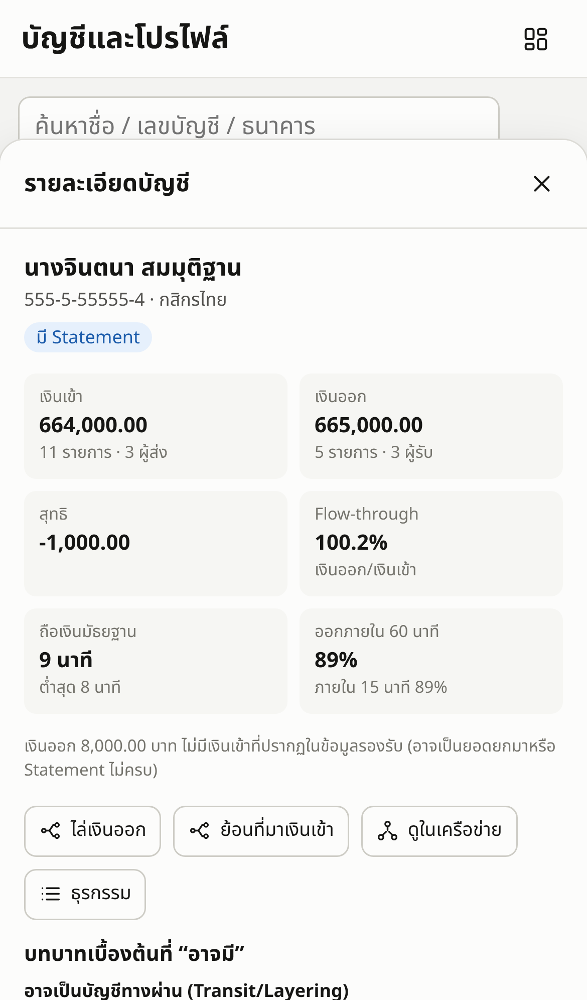

# Bank Account Analyzer — วิเคราะห์การเงินเชิงสืบสวน

เว็บแอปสำหรับงานวิเคราะห์ข้อมูลทางการเงินเชิงสืบสวน: นำเข้า Statement ธนาคาร **หลายบัญชี** → วิเคราะห์ **ความเชื่อมโยงและเส้นทางเงิน** → จัดทำ **รายงานประกอบการสืบสวน** (PDF + Excel)
ออกแบบให้ใช้งานหลักบน **คอมพิวเตอร์** และใช้บน **iPhone** ได้ (ติดตั้งลงหน้าจอโฮมเป็นแอปได้)

> **ข้อมูลทั้งหมดประมวลผลและเก็บในเครื่องของคุณเท่านั้น** — ไม่มีเซิร์ฟเวอร์ ไม่มีการอัปโหลดไฟล์ ไม่เรียกบริการภายนอก (ฟอนต์ ตัวอ่าน PDF และ OCR ภาษาไทยถูกรวมไว้ในแอป ใช้งานออฟไลน์ได้)


## ความสามารถ

| ด้าน | รายละเอียด |
|---|---|
| **นำเข้าหลายบัญชี** | ลากวางหลายไฟล์พร้อมกัน — CSV (UTF‑8 / Windows‑874), Excel `.xlsx` (หลายชีต · **รองรับไฟล์ที่ตั้งรหัสผ่าน** แบบ Office 2010 ขึ้นไป ถอดรหัสในเบราว์เซอร์), PDF ที่เลือกข้อความได้ (รองรับ PDF ที่มีรหัสผ่าน), PDF สแกน/รูปภาพ (OCR ภาษาไทย+อังกฤษในเบราว์เซอร์) · 1 ไฟล์ = 1 บัญชี |
| **อ่านรูปแบบไทย** | วันที่ พ.ศ./ค.ศ. เลขไทย เดือนไทย · ถอน/ฝาก แยกคอลัมน์, คอลัมน์เดียวมีเครื่องหมาย, Dr/Cr, ไฟล์เรียงใหม่→เก่า · เดาคอลัมน์จากหัวตารางไทย/อังกฤษ + หน้าจับคู่คอลัมน์ให้แก้ได้ + จำรูปแบบไว้ใช้ซ้ำ |
| **รูปแบบ Statement ของธนาคาร** | จำโครงสร้างไฟล์จริง 4 แบบจากลายเซ็นของหัวตาราง (กสิกรไทย · ไฟล์ส่งออกมาตรฐานแบบ SCB · ธ.ก.ส. · กรุงไทย) แล้วจับคู่คอลัมน์ ระบุเจ้าของบัญชี ทิศทางเงิน และคู่บัญชีให้เอง — ดูหัวข้อ “[รูปแบบ Statement ที่ระบบรู้จัก](#รูปแบบ-statement-ที่ระบบรู้จัก)” |
| **หลักฐานเสริมในไฟล์** | เก็บ IP, รหัส/ธนาคารของตู้ ATM, พิกัด, สาขา, เบอร์โทร ฯลฯ ที่มากับรายการ → แสดงในแผงรายละเอียดธุรกรรม ค้นหาได้ (คลิก IP / รหัสตู้ / เบอร์โทร เพื่อค้นธุรกรรมอื่นที่มีค่าเดียวกัน) และมีคอลัมน์ในไฟล์ Excel · เป็น **ข้อมูลประกอบให้ตรวจต่อ** ไม่ใช่ข้อสรุป (ดู “ข้อจำกัด”) |
| **คุณภาพข้อมูล** | ตรวจยอดคงเหลือต่อเนื่อง, ตัดรายการซ้ำข้ามไฟล์, แสดงแถวที่ถูกข้ามพร้อมเหตุผล, SHA‑256 ของไฟล์ต้นฉบับ, ไฮไลต์ค่า OCR ที่ความมั่นใจต่ำให้แก้ก่อนนำเข้า |
| **เชื่อมหลายบัญชี** | จับคู่รายการที่ปรากฏทั้งสองฝั่ง (A โอนให้ B) นับเป็นรายการเดียว · เลขบัญชีที่ถูกปิดบางส่วน (`xxx-x-x1234-x`) ไม่ถูกรวมเองโดยพลการ — เสนอให้ผู้ใช้ยืนยัน |
| **วิเคราะห์** | โปรไฟล์ต่อบัญชี, Flow‑through, Holding Time (FIFO), Top Sender/Receiver, **Rapid Movement, Structuring/Splitting, Convergence, Layering/Transit, Circular, Cash‑out, Cross‑bank, Repeated, ยอดใต้วงเงิน** (ปรับเกณฑ์ได้) |
| **Money Trail** | ไล่เงินออก (Forward) / ย้อนที่มา (Backward) จากบัญชีหรือรายการ — แผนภาพลำดับตามเวลา + ปลายทาง/ต้นทาง |
| **Network** | ผังเครือข่ายโต้ตอบ — มุมมอง **แกนหลัก** (เจ้าของ Statement วางบนวงกลม พร้อมคู่บัญชีที่เงินไหลมากสุดต่อเจ้าของ และบัญชีร่วมที่เชื่อมหลายเจ้าของ) หรือ **ทุกบัญชี** · รูปแบบการจัดผัง **อัตโนมัติ** หรือ **วงซ้อน** (เจ้าของ Statement วงใน บัญชีร่วมวงถัดมา คู่บัญชีของเจ้าของแต่ละรายแผ่ออกไปด้านเดียวกับเจ้าของ) · **ลากจุดจัดเองแล้วระบบจำไว้ในคดี** (แยกตามรูปแบบ) พร้อมตัวกรองที่ใช้ — เปิดใหม่ได้ผังเดิม และภาพผังในรายงาน PDF ออกมาตามที่จัดไว้ · ระบายสีตาม **บทบาท / ธนาคาร / ชุมชน** พร้อมคำอธิบายสี · เส้นเข้า/ออกแยกสี ความหนาตามยอด · Degree, Betweenness, จุดตัด · กรองตามยอด/วันที่ · **คลิกขวา (หรือกดค้างบนจอสัมผัส) ที่จุดบัญชีเพื่อตั้งชื่อ-นามสกุล ที่มา และใส่รูปบุคคล** — ชื่อแสดงแทนในทุกหน้า รูปแสดงในจุดบนผัง โดยผังไม่จัดวางใหม่ · **คลิกขวา (หรือกดค้าง) ที่พื้นที่ว่างหรือบนเส้น** เปิดเมนูผัง: แสดงรายละเอียดเส้นเงินทุกเส้น (ยอด × จำนวนครั้ง) หรือ **แบบการ์ด** (ยอด จำนวนรายการ ช่วงวันที่) · ปักรายละเอียดเฉพาะเส้น · ดูธุรกรรมของเส้นนั้น · **เพิ่มข้อความตรงนี้** (โน้ตของผู้สืบสวน ลากย้าย/แก้/ลบได้) · เลือกทั้งหมด (Ctrl+A) · โหมดมือ/โหมดเลือก (H — ลากกรอบเลือกหลายจุดแล้วย้ายพร้อมกัน) · จัดวาง · พอดีจอ · **ไอคอนธนาคารทุกโหนด** (ตัวย่อธนาคาร ไม่ใช่โลโก้จริง) — ตัวเลือกและโน้ตบันทึกในคดี และใช้กับภาพผังในรายงาน (มีรายการ “ข้อความประกอบผัง” ใต้ภาพ) · เพิ่มบุคคล/โทรศัพท์/ยานพาหนะและความสัมพันธ์จากหลักฐานอื่น · ส่งออก PNG |
| **หน้าตา** | ธีมสีไลต์/ดาร์กตามระบบ · สีแยกธนาคาร/ชุมชนบนผังใช้ชุด 4 สีที่ผ่านตัวตรวจความแยกออกสำหรับผู้เห็นสีไม่ครบ (ลำดับที่ 5 ขึ้นไปใช้สีกลาง) และ **ไม่พึ่งสีอย่างเดียว** — ทุกจุดมีป้ายชื่อ/รหัสธนาคาร+เลขท้าย 4 หลัก, ขนาด/วงแหวน/เส้นประแยกบทบาท · สีตกแต่งไม่ถูกใช้แทนระดับความผิด (ดู “หลักการที่ฝังอยู่ในแอป”) |
| **Timeline** | ธุรกรรม สัญญาณ และเหตุการณ์ที่ผู้สืบสวนบันทึก (ATM/CCTV การจับกุม ข้อมูลภาคสนาม) บนแกนเวลาเดียว |
| **ผลวิเคราะห์ 4 ระดับ** | ระบบร่าง ข้อเท็จจริง / ข้อสังเกต / สมมติฐาน / ข้อเสนอแนะ จากข้อมูลจริง ให้แก้ไขและเลือกใส่รายงาน + คำอธิบายทางเลือกที่ต้องพิจารณา |
| **รายงาน** | **PDF** ภาษาไทย A4 (ปก, บทสรุป, คุณภาพข้อมูล, โปรไฟล์ + กราฟ, คู่บัญชี, Money Trail, ผังเครือข่าย, ไทม์ไลน์, ผลวิเคราะห์, ข้อจำกัด, ภาคผนวกพารามิเตอร์/SHA‑256/ธุรกรรมหลักฐาน) และ **Excel** 8 ชีต |
| **ส่วนตัวและพกพา** | เก็บใน IndexedDB, ส่งออก/นำเข้า “ไฟล์คดี” เข้ารหัส AES‑256‑GCM เพื่อสำรองและย้ายระหว่างคอมพิวเตอร์ ↔ iPhone, ปุ่มลบข้อมูลทั้งหมด · รูปบุคคลถูกตัดเป็นจัตุรัสและย่อเหลือ 256 px ในเบราว์เซอร์ เก็บในคดีและไปกับไฟล์คดีที่เข้ารหัส ส่วนในภาพผังของรายงาน PDF เป็นตัวเลือกที่ปิดไว้ก่อน |

| Money Trail | ผังเครือข่าย (แกนหลัก · โหมดไลต์) |
|---|---|
|  |  |

| ผังเครือข่าย (โหมดมืด) | หน้านำเข้า — ตรวจพบรูปแบบ Statement ของธนาคาร |
|---|---|
|  |  |

| iPhone — แผงรายละเอียดบัญชี |
|---|
|  |

> ภาพทั้งหมดสร้างจาก **ข้อมูลสมมติ** (ปุ่ม “ทดลองด้วยข้อมูลสมมติ” และไฟล์สังเคราะห์จาก `npm run fixtures`)

## เริ่มใช้งาน

### เปิดผ่านเว็บ (ไม่ต้องติดตั้ง)

แอปเผยแพร่เป็นไฟล์สถิตบน GitHub Pages: **https://chalee2000.github.io/Bank-Account-Analyzer/**

- ใช้ได้ทั้งคอมพิวเตอร์และ iPhone — บน iPhone เปิดด้วย Safari → ปุ่มแชร์ → **เพิ่มลงในหน้าจอโฮม** (เป็น HTTPS จึงมีโหมดออฟไลน์และส่งออกไฟล์คดีเข้ารหัสได้)
- เซิร์ฟเวอร์ส่งให้เฉพาะตัวแอป (HTML/JS/ข้อมูล OCR) — **Statement และคดีไม่ถูกอัปโหลด** ประมวลผลและเก็บในเบราว์เซอร์ของคุณเท่านั้น
- ครั้งแรกที่ใช้ OCR เบราว์เซอร์จะโหลดข้อมูลภาษาไทย/อังกฤษราว 26 MB แล้วเก็บไว้ใช้ออฟไลน์
- หน้าเว็บตั้งค่าไม่ให้เสิร์ชเอนจินจัดทำดัชนี (`noindex`, `robots.txt`)

ผู้ดูแลรีโป: ตั้งค่าครั้งเดียวที่ Settings → Pages → Build and deployment → Source = **GitHub Actions** หลังจากนั้นทุกครั้งที่ push ลง branch หลัก workflow `.github/workflows/pages.yml` จะรันเทสต์ สร้างไฟล์ และเผยแพร่ให้อัตโนมัติ (GitHub Pages ฟรีสำหรับรีโป public — รีโป private ต้องใช้แผน GitHub Pro ขึ้นไป)

### รันในเครื่อง

ต้องมี **Git** และ **Node.js 22 LTS ขึ้นไป** (เครื่องมือ build ต้องการ Node 20.19+ ส่วนชุดทดสอบต้องการ 22.12+) — ถ้ายังไม่มี Node.js ให้ติดตั้งรุ่น LTS จาก https://nodejs.org แล้ว **ปิดและเปิด Command Prompt / Terminal ใหม่** ก่อนรันคำสั่งด้านล่าง (ตรวจด้วย `node -v` และ `npm -v` ต้องขึ้นเลขเวอร์ชัน)

```bash
git clone https://github.com/chalee2000/Bank-Account-Analyzer.git
cd Bank-Account-Analyzer
npm install
npm run dev          # http://localhost:5173  (พัฒนา)
npm run build        # สร้างไฟล์สถิตที่ dist/
npm run preview      # ดูผล build ที่ http://localhost:4173
```

`dist/` เป็นไฟล์สถิตล้วน นำไปวางบนเว็บเซิร์ฟเวอร์ใดก็ได้ (Nginx, Apache, GitHub Pages, ไฟล์เซิร์ฟเวอร์ภายในหน่วยงาน) ได้ทันที
> ต้องเปิดผ่าน **HTTPS หรือ `localhost`** เพื่อให้ Service Worker (ออฟไลน์/ติดตั้งแอป) และการเข้ารหัสไฟล์คดีทำงาน — ถ้าเปิดผ่าน `http://` ในเครือข่ายภายใน แอปยังใช้งานได้ แต่จะไม่มีโหมดออฟไลน์

### ใช้บน iPhone
1. เปิด URL ของแอป (HTTPS) ใน Safari → ปุ่มแชร์ → **เพิ่มลงในหน้าจอโฮม**
2. นำเข้าไฟล์จากแอป “ไฟล์” หรือรูปถ่าย Statement · รายงาน PDF: หน้า “รายงาน” → พิมพ์ → ถ่างนิ้วบนภาพตัวอย่าง → แชร์ → บันทึกลงไฟล์
3. ย้ายคดีระหว่างเครื่อง: หน้า “ตั้งค่า” → ส่งออกไฟล์คดี (ตั้งรหัสผ่าน) → AirDrop/ไฟล์ → “คดีทั้งหมด” → นำเข้าไฟล์คดี
4. iOS อาจล้างข้อมูลเว็บที่ไม่ได้เปิดนาน — **ติดตั้งลงหน้าจอโฮมและส่งออกไฟล์คดีสำรองเป็นประจำ** · งานหนัก (OCR หลายสิบหน้า, ผังขนาดใหญ่มาก) แนะนำทำบนคอมพิวเตอร์

## ขั้นตอนการทำงาน

1. **คดีทั้งหมด** → สร้างคดี (หรือกด “ทดลองด้วยข้อมูลสมมติ” เพื่อดูตัวอย่างทั้งหมด)
2. **นำเข้าไฟล์** → ลาก Statement ของแต่ละบัญชี → ตรวจ 4 ขั้น: บัญชีเจ้าของ → จับคู่คอลัมน์ → ตัวอย่างข้อมูล (OCR แก้ได้) → ผลการอ่าน → กด “นำเข้า”
3. **ภาพรวม / บัญชี / ธุรกรรม** → ดูโปรไฟล์ กรอง ค้นหา คัดลอกเป็น TSV (วางใน Excel)
4. **รูปแบบ/สัญญาณ** → ดูรูปแบบที่ควรตรวจ เปิดหลักฐานรายธุรกรรม เพิ่มเข้าผลวิเคราะห์
5. **เส้นทางเงิน / เครือข่าย / ไทม์ไลน์** → ไล่เงิน ดูผัง บันทึกเหตุการณ์และความสัมพันธ์ที่ได้จากหลักฐานอื่น
6. **ผลวิเคราะห์** → ตรวจ/แก้ข้อความ 4 ระดับ ติ๊ก “ใส่ในรายงาน” บันทึกคำอธิบายทางเลือก
7. **รายงาน** → บันทึกเป็น PDF / ส่งออก Excel

คีย์ลัด: `/` โฟกัสช่องค้นหา · `Esc` ปิดแผงรายละเอียด · `Alt+1…9,0` สลับหน้า

## หลักการที่ฝังอยู่ในแอป

อ้างอิงแนวทางการวิเคราะห์เส้นทางการเงินเชิงสืบสวน (Money Trail, Network/Link Analysis, Pattern, Holding Time, Flow‑through):

- **ไม่สรุปความผิดจากธุรกรรมเพียงอย่างเดียว** — ข้อความที่ระบบสร้างใช้ “พบว่า…”, “อาจมีบทบาท…”, “ควรตรวจสอบเพิ่มเติม…” และมีเทสต์ตรวจว่าไม่มีคำชี้ชัดอย่าง “บัญชีม้า/ผู้สั่งการ/เงินค่ายา” หลุดออกไป
- **สัญญาณ = รูปแบบที่ควรตรวจต่อ** ไม่ใช่ข้อพิสูจน์ ความเด่นแสดงเป็นจุด ●●● (ไม่ใช้สีแดง/เหลืองเพื่อไม่สื่อถึงระดับความผิด)
- **คะแนนลำดับการตรวจสอบ** แสดงแยก 7 องค์ประกอบ เป็นค่าสัมพัทธ์ในคดี พร้อมข้อความกำกับว่า “ไม่ใช่คะแนนความผิด”
- **บทบาทของบัญชี** (จุดรวมเงิน, ทางผ่าน, จุดเชื่อม ฯลฯ) แสดงเป็น “อาจมีบทบาท…” พร้อมเหตุผลเชิงข้อมูล · Degree/Betweenness สูง ≠ ความผิด
- **ข้อจำกัดและข้อความปิดท้ายมาตรฐานแนบทุกรายงาน** แก้ไขหรือลบไม่ได้

### เกณฑ์ตั้งต้นของสัญญาณ (ปรับได้ที่หน้า “ตั้งค่า” และแนบในภาคผนวกของรายงานทุกฉบับ)

| รูปแบบ | เกณฑ์ตั้งต้น |
|---|---|
| Rapid Movement | เงินออก ≥ 80% ของที่รับ ภายใน 60 นาที (ยอดรับ ≥ 10,000) |
| Structuring | ≥ 3 รายการ ยอดใกล้กัน ±15% ภายใน 60 นาที ไปอย่างน้อย 2 บัญชี |
| Convergence | ≥ 3 บัญชีโอนเข้าบัญชีเดียวภายใน 120 นาที |
| Layering | ส่งต่อ ≥ 3 ทอด ทอดละ ≤ 120 นาที ยอดเหลือ ≥ 85% |
| Circular | เงินวนกลับบัญชีต้นทางภายใน 72 ชั่วโมง |
| Cash‑out | ถอนเงินสดที่ ≥ 50% ตรงกับเงินโอนเข้าภายใน 120 นาทีก่อนหน้า |
| Repeated | รูปแบบเดิมหรือคู่บัญชี/ยอดเดิมเกิดซ้ำ ≥ 3 วัน |

### วิธีจับคู่เงินเข้า–ออก (สำคัญ)
Holding Time และ Money Trail ใช้การจับคู่ **เข้าก่อนออกก่อน (FIFO)** ต่อบัญชี — เงินเป็นสิ่งที่ทดแทนกันได้ จึงเป็น **สมมติฐาน** ไม่ใช่การยืนยันว่าเป็นเงินก้อนเดียวกัน (ระบุไว้ในหน้าจอ รายงาน และข้อจำกัด) เวลาที่ใช้คือ “เวลาตามที่ปรากฏใน Statement” โดยไม่ขึ้นกับเขตเวลาของเครื่อง ไฟล์ที่ไม่มีเวลาวิเคราะห์ได้ระดับวันและติดธงเตือน

## รูปแบบ Statement ที่ระบบรู้จัก

ระบบตรวจ **ลายเซ็นของหัวตาราง** (ไม่ดูชื่อไฟล์) — ถ้าตรงกับรูปแบบด้านล่าง จะจับคู่คอลัมน์ ระบุเจ้าของบัญชี ทิศทางเงินและคู่บัญชีให้เอง พร้อมป้าย “ตรวจพบรูปแบบ: …” ในหน้านำเข้า ถ้าไม่ตรงจะถอยไปใช้การเดาทั่วไปเหมือนเดิม และแก้การจับคู่คอลัมน์ได้เสมอ

| รูปแบบ | ลักษณะของไฟล์ | สิ่งที่ระบบจัดการให้ |
|---|---|---|
| **กสิกรไทย** — ต้นทาง/ปลายทาง + ถอน/ฝาก | หัวเอกสาร 3 บรรทัด · วันที่/เวลาเป็นข้อความ (พ.ศ.) · ธนาคาร/เลขบัญชี/ชื่อ ต้นทางและปลายทางแยกคอลัมน์ · ถอนและฝากแยกคอลัมน์ | ขาเข้าใช้ฝั่ง “ต้นทาง” เป็นคู่บัญชี ขาออกใช้ฝั่ง “ปลายทาง” · แถว “เปิดบัญชี” ยอด 0 ถูกข้ามพร้อมเหตุผล · เก็บ IP, รหัสตู้ ATM, ธนาคารเจ้าของตู้, พิกัด (ตัดพิกัด 0,0), Teller, สาขา, เลขเช็ค · ตรวจยอดคงเหลือต่อเนื่อง |
| **ไฟล์ส่งออกมาตรฐานจากธนาคาร** (พบกับ SCB) | หัวตารางอังกฤษราว 32 คอลัมน์ (`txdate`, `fromaccountno`, `tobankcode` …) · เลขบัญชีเป็นตัวเลขใน Excel · บางไฟล์มีชีตที่สองเป็นข้อความดิบตัวอักษรเพี้ยน | เลือกชีตข้อมูลที่ถูก (ไม่ใช่ชีตดิบ) · เติม 0 นำหน้าที่ Excel ตัดทิ้งตามความยาวเลขบัญชีของแต่ละธนาคาร · อ่านธนาคารจากรหัสตัวเลข ธปท. · แถวที่เรียงไม่ตรงเวลา → จัดเรียงใหม่ · ธุรกรรมประเภท “อื่นๆ” ไม่นับเป็นถอนเงินสด · **ยอดปัดเป็นบาทเต็มแต่ยอดคงเหลือมีสตางค์** → ยอมให้ยอดคงเหลือคลาดไม่เกิน 0.50 บาท เฉพาะกรณีนี้ และแจ้งเป็นหมายเหตุ |
| **ธ.ก.ส.** — รายการเคลื่อนไหวธุรกรรม | หัวเอกสารเป็นเซลล์ merge (ชื่อ/ที่อยู่/สถานะ/วันที่เปิด/ID) · วันที่เป็น Date จริงที่ปีเป็น พ.ศ. · จำนวนเงิน **คอลัมน์เดียว** + คงเหลือ · ท้ายตารางมี “รวมทั้งสิ้น N รายการ” | ทิศทางจากส่วนต่างของยอดคงเหลือ (แถวแรกใช้คำสำคัญและติดธง) · **ยอดติดลบ = กลับรายการ** ไม่ใช่เงินออก · ดอกเบี้ยจ่าย = เงินเข้า · อ่านผู้โอน/รหัสตู้/เลขอ้างอิงจากช่อง “รายละเอียดธุรกรรม” · ตรวจจำนวนแถวกับท้ายตาราง · เก็บข้อมูลหัวเอกสารเป็นข้อมูลบัญชี |
| **กรุงไทย** — ผู้โอน / ผู้รับโอน | หัวเอกสารบรรทัดเดียว (เลขบัญชี/ชื่อ/เลขประจำตัวประชาชน) · หัวตารางมี merge (ธนาคาร + บัญชี) · จำนวนเงินคอลัมน์เดียว **ไม่มียอดคงเหลือ** | ทิศทางจากช่อง “รายการ” (ฝาก/ถอน/ชำระ) และจากฝั่งที่เจ้าของบัญชีอยู่ (ผู้โอน = เงินออก, ผู้รับโอน = เงินเข้า) — **ไม่เดา** · รู้จัก “ทีทีบี” · ไม่มียอดคงเหลือจึงตรวจความต่อเนื่องของยอดไม่ได้ |

ข้อควรรู้ (พูดตรง ๆ):

- 4 รูปแบบนี้ **ตรวจกับไฟล์ตัวอย่างจริงเพียงรูปแบบละ 1 แหล่ง** (ไฟล์ส่งออกมาตรฐานมี 2 ไฟล์ แต่เป็นรูปแบบเดียวกัน) — ธนาคารเดียวกันอาจมีหลายรูปแบบ (ต่างช่องทางส่งออก/ต่างรุ่นระบบ) ถ้าลายเซ็นไม่ตรงจะใช้การเดาทั่วไป จึงควรตรวจหน้า “ผลการอ่าน” (จำนวนแถวที่อ่านได้/ถูกข้าม ทิศทางมาจากอะไร ยอดคงเหลือต่อเนื่องหรือไม่) ทุกครั้งก่อนนำเข้า
- ไฟล์ตัวอย่างจริงเป็นข้อมูลของผู้ใช้ ไม่ได้นำมาเก็บในรีโป — เทสต์ใช้ไฟล์สังเคราะห์ที่จำลองโครงสร้างและความแปลกของไฟล์จริงด้วยค่าที่สมมติขึ้น (`tests/helpers/bankSamples.ts`)
- ตรวจไฟล์ใหม่ก่อนนำเข้าจากบรรทัดคำสั่งได้ (ประมวลผลในเครื่อง ไม่ส่งข้อมูลออก):

  ```bash
  npm run check -- <ไฟล์> [รหัสผ่าน]
  ```

  แสดงรูปแบบที่ตรวจพบ เจ้าของบัญชี จำนวนแถวที่อ่านได้และถูกข้ามพร้อมเหตุผล ทิศทางมาจากอะไร ยอดคงเหลือต่อเนื่องหรือไม่ หลักฐานเสริมที่พบ และธงเตือน
- เลขประจำตัวประชาชน/ID ที่มากับหัวเอกสารถูกเก็บเป็น “ข้อมูลบัญชี” แสดงเฉพาะในแผงรายละเอียดบัญชี **ไม่ใส่ในรายงาน PDF และไฟล์ Excel**

## รูปแบบไฟล์และข้อจำกัดที่ควรรู้

- **รูปแบบนอกเหนือจาก 4 แบบข้างต้น** ใช้การเดาคอลัมน์จากหัวตารางทั่วไป + หน้าจับคู่คอลัมน์ (ระบบจำไว้ให้) ทดสอบกับไฟล์สังเคราะห์หลายรูปแบบ (ดูหัวข้อการทดสอบ) ยังไม่ได้ทดสอบกับ Statement จริงของทุกธนาคาร ถ้าไฟล์ของธนาคารใดอ่านไม่ถูก ให้แก้การจับคู่คอลัมน์ในหน้านำเข้า หรือส่งตัวอย่างที่ลบข้อมูลส่วนบุคคลแล้วเพื่อเพิ่มรองรับ
- **Excel ที่ตั้งรหัสผ่านรองรับเฉพาะแบบ Office 2010 ขึ้นไป** (Agile / AES) — ไฟล์ที่เข้ารหัสแบบ Office 2007 ยังไม่รองรับ (ระบบแจ้งวิธีบันทึกใหม่) · รหัสผ่านใช้ถอดไฟล์ในเครื่องเท่านั้น ไม่ถูกบันทึกหรือส่งออก · ถอดรหัสในเบราว์เซอร์ใช้เวลาราว 0.5 วินาที
- **ไม่รองรับ `.xls` รุ่นเก่า** — บันทึกเป็น `.xlsx` หรือ `.csv` ก่อน
- **หลักฐานเสริม (IP / รหัสตู้ / พิกัด) เป็นข้อมูลประกอบ ไม่ใช่ข้อสรุป** — IP ที่ซ้ำข้ามบัญชีในไฟล์ตัวอย่างจริงพบมาก แต่ส่วนใหญ่เป็น IP ภายในหรือ IP ของผู้ให้บริการมือถือที่หลายคนใช้ร่วมกัน จึง **ไม่ถูกนำไปสร้างสัญญาณอัตโนมัติ** — ให้ค้นหา/คลิกดูธุรกรรมที่มีค่าเดียวกันแล้วผู้สืบสวนตีความเอง
- **ยอดปัดบาทเต็มและการปรับยอดย้อนหลัง** — ไฟล์ที่ปัดจำนวนเงินเป็นบาทเต็ม (พบในไฟล์ส่งออกมาตรฐาน) อาจทำให้จับคู่รายการกับ Statement ของอีกฝั่งไม่ได้เมื่อเศษสตางค์ต่างกัน · รายการที่ธนาคารปรับย้อนหลัง (เช่น ปรับดอกเบี้ยลงวันที่ย้อนหลัง) ทำให้ยอดคงเหลือไม่ต่อเนื่องเล็กน้อย — ระบบแจ้งเตือน ไม่แก้ตัวเลขเอง
- **บัญชีชื่อเดียวกันข้ามธนาคาร** ระบบไม่รวมให้เอง (ชื่อซ้ำไม่ใช่ข้อพิสูจน์ว่าเป็นบุคคลเดียวกัน) — เพิ่มความสัมพันธ์เองได้ที่หน้าเครือข่าย
- **คู่บัญชีที่อยู่ในข้อความรายละเอียด** (เช่น “โอนเงินไป กสิกรไทย 123‑4‑56789‑0 นาย ก”) ถูกอ่านแบบเดา ติดธง “อนุมาน” ให้ตรวจกับต้นฉบับ
- **OCR** ภาษาไทยแม่นยำไม่เท่าไฟล์ดิจิทัล (ภาพสังเคราะห์ที่สะอาดอ่านได้ถูกเกือบทั้งหมด — ในชุดทดสอบ 12 แถวพบเพี้ยน 1 จุดที่เวลา และเลขบัญชีคู่โอนอ่านผิดอีก 1 จุด ภาพถ่ายจริงจะคลาดเคลื่อนมากกว่า) จึงมีขั้นตรวจแก้ก่อนนำเข้าเสมอ และระบบ **ไม่เดาค่าที่อ่านไม่ชัด** — แถวที่ระบุวันที่/ยอด/ทิศทางไม่ได้จะถูกข้ามพร้อมเหตุผล · ถ้ารายการสองฝั่งอ่านเลขบัญชีเพี้ยน ระบบจะรวมให้จากยอดและเวลาเฉพาะกรณีที่เป็นคู่เดียวที่เป็นไปได้ และติดธง “จับคู่จากยอดและเวลาเท่านั้น”
- ข้อความที่คัดลอกจาก PDF รายงานอาจมีวรรณยุกต์บางตัวหายเมื่อเปิดด้วยบางโปรแกรม (ภาพพิมพ์และการค้นหาในโปรแกรม PDF ทั่วไปถูกต้อง)

## ความปลอดภัยและความเป็นส่วนตัว

- ไม่มีคำขอเครือข่ายออกนอกเครื่องขณะใช้งาน (ตรวจใน E2E) · CSP จำกัดให้โหลดเฉพาะจาก origin เดียวกัน
- การถอดรหัสไฟล์ Excel ทำในเบราว์เซอร์ด้วย `@noble/hashes` และ `@noble/ciphers` (ไม่ใช้ Web Crypto แบบ async เพราะช้าเกินไปสำหรับการวนแฮช 100,000 รอบ) — รหัสผ่านของไฟล์ไม่ถูกบันทึกลงเครื่องหรือไฟล์คดี
- ไฟล์คดีที่ส่งออกเข้ารหัส AES‑256‑GCM คีย์จากรหัสผ่านด้วย PBKDF2‑SHA256 (250,000 รอบ) — ลืมรหัสผ่านกู้คืนไม่ได้
- ข้อมูลอยู่ใน IndexedDB ของเบราว์เซอร์ — เครื่องที่ใช้ร่วมกับผู้อื่นควรลบข้อมูลหลังใช้งาน (หน้า “ตั้งค่า” → ลบข้อมูลทั้งหมด) หรือใช้โปรไฟล์เบราว์เซอร์แยก
- `npm audit` แจ้งช่องโหว่ระดับปานกลางของ `uuid` ผ่าน `exceljs` (กรณีเรียก v3/v5/v6 พร้อม buffer) — แอปไม่ได้ใช้ทางนั้นกับข้อมูลภายนอก แต่ควรติดตามการอัปเดตของ `exceljs`

## การทดสอบ

```bash
npm test                  # Vitest: 171 ข้อ (core, ingest, รูปแบบธนาคาร, ถอดรหัส Excel, analysis, ผังเครือข่าย/รูปแบบการจัดผัง/ป้ายเส้น/โน้ต, รูปบุคคล, store, Excel)
npm run fixtures          # สร้างไฟล์ Statement สังเคราะห์หลายรูปแบบที่ tests/fixtures/generated/ (ต้องมี Chromium)
npm run test:e2e          # Playwright: desktop 11 ข้อ + iPhone 2 ข้อ (จำลองด้วย Chromium) — build ใหม่ทุกครั้งก่อนรัน
npm run check -- <ไฟล์> [รหัสผ่าน]   # ตรวจว่าไฟล์จริงจะถูกอ่านอย่างไร (ไม่ใช่เทสต์)
```

- ชุดทดสอบหลักใช้ **ตัวอย่างโครงสร้าง A → B1,B2,B3 → C → D → E → F → ATM** ตรวจว่าพบ Structuring, Convergence, Layering, Cash‑out และไล่เส้นทางไปหน้า/ย้อนกลับได้ถูกต้อง
- `npm run fixtures` สร้างไฟล์ 8 รูปแบบจากสถานการณ์เดียวกัน (CSV พ.ศ., Excel, CSV Windows‑874, PDF ข้อความ, CSV Dr/Cr เรียงย้อน, TSV เลขไทย, PDF สแกน, รูปภาพ) + PDF มีรหัสผ่าน + ไฟล์ 20,000 แถว แล้วทดสอบว่าอ่านกลับได้ตรงต้นทาง และผลวิเคราะห์ตรงกับข้อมูลต้นฉบับ (E2E: 17 บัญชี 52 ธุรกรรม 32 รายการสองฝั่ง)
- **รูปแบบธนาคาร:** `npm run fixtures` สร้างไฟล์จำลองโครงสร้างของ 4 รูปแบบ (`bank_*_like.xlsx`) จากตัวสร้างใน `tests/helpers/bankSamples.ts` ด้วยค่าที่สมมติขึ้นทั้งหมด (เลขบัญชี ชื่อ IP พิกัด ฯลฯ) — ทดสอบหน่วยตรวจรูปแบบ ทิศทาง คู่บัญชี ยอดปัดบาทเต็ม ยอดติดลบ และ E2E นำเข้าทั้ง 4 ไฟล์ + Excel ที่ตั้งรหัสผ่าน (`tests/fixtures/static/agile-encrypted.xlsx`, รหัสมีอักษรไทย) แล้วดูผังเครือข่าย
- **ผังเครือข่าย:** ทดสอบการสร้างผัง (เจ้าของบนวงกลม รัศมีตามจำนวนจุด สีไม่เกินชุดที่ตรวจแล้ว ป้ายกำกับ) และการจัดให้พอดีจอโดยเว้นพื้นที่แผงเครื่องมือ/คำอธิบายสี รวมถึงกรณีเปิดหน้าก่อนวิเคราะห์เสร็จ (เคยทำให้ผังไม่ขึ้น)
- **ชื่อและรูปบุคคล:** E2E คลิกขวาที่จุดคู่บัญชี → ตั้งชื่อ + ใส่รูปสังเคราะห์ → ตรวจว่าจุดได้ชื่อและรูปจริง (นับพิกเซลบนผัง) ทุกจุดอยู่ที่เดิม แผงบัญชีแสดงรูป รีโหลดแล้วยังอยู่ และภาพผังในรายงานไม่มีรูปจนกว่าจะติ๊กตัวเลือก
- **รูปแบบการจัดผังและตำแหน่งที่จัดเอง:** unit ตรวจว่าวงซ้อนวางเจ้าของวงใน คู่บัญชีอยู่ฝั่งเดียวกับเจ้าของ ไม่มีจุดซ้อนกันแม้จุดเยอะ และการเลือกใช้ตำแหน่งที่บันทึก; E2E เลือกวงซ้อน → ลากจุด → รีโหลดแล้วอยู่ที่เดิม → สลับรูปแบบไปมาแล้วตำแหน่งยังอยู่ → รายงานบอกว่าจัดตามที่ผู้สืบสวนจัดไว้ → “จัดเรียงใหม่” ล้างได้
- **เมนูคลิกขวาบนผัง:** unit ตรวจคลาสป้ายเส้นปกติ/การ์ด/ปัก ข้อความการ์ด (ยอด จำนวนรายการ ช่วงวันที่) ไอคอนธนาคารเฉพาะจุดบัญชีและไม่ทับรูปบุคคล สีตัวอักษรบนไอคอนต่างจากพื้นอย่างน้อย 4.5:1 การสลับตัวเลือกไม่ทำให้จัดผังใหม่ และการจัดวาง/บันทึกตำแหน่งไม่แตะโน้ต; E2E คลิกขวาที่ว่าง → เปิดป้ายเส้น → การ์ด → ไอคอนธนาคาร (จุดไม่ขยับ) → เพิ่ม/ลาก/แก้โน้ต → รีโหลดแล้วยังอยู่ → Ctrl+A / Esc / H → คลิกขวาบนเส้น → ดูธุรกรรมของคู่บัญชีนั้น → รายงานมีรายการข้อความประกอบผัง · กดค้างบนจอสัมผัส (จำลอง iPhone) แล้วเมนูไม่ปิดเองเมื่อยกนิ้ว
- ประสิทธิภาพที่วัดได้ (Chromium, เครื่องทดสอบ): นำเข้า+วิเคราะห์ 20,000 แถวราว 2 วินาที, กรองข้อความในตารางราว 0.3 วินาที
- **ข้อจำกัดของการทดสอบ:** ทดสอบด้วย Chromium เท่านั้น ยังไม่ได้ทดสอบบน Safari/iOS จริง — พฤติกรรมเฉพาะ iOS (การเลือกไฟล์, ขั้นตอนบันทึก PDF, การล้างข้อมูลของ Safari, หน่วยความจำขณะ OCR) ควรลองบน iPhone จริง · รูปแบบธนาคารทั้ง 4 ตรวจกับไฟล์จริงเพียงรูปแบบละ 1 แหล่ง (ดู “รูปแบบ Statement ที่ระบบรู้จัก”) · ไฟล์ทดสอบและภาพประกอบทั้งหมดใช้ข้อมูลสมมติ

## โครงสร้างโปรเจกต์

```
src/core/        types, thai (พ.ศ./เลขไทย/จำนวนเงิน), normalize (เลขบัญชี/ธนาคาร/รหัส ธปท./ชื่อ)
src/ingest/      csv, xlsx, pdf (pdf.js), ocr (tesseract.js), cfb + ooxmlCrypto (ถอดรหัส Excel), formats (ตรวจรูปแบบธนาคารจากหัวตาราง),
                 details (แม่แบบรายละเอียด ธ.ก.ส.), tableFromItems, detectColumns, parseRows, consolidate (dedupe + mirror)
src/analysis/    attribution (FIFO), profile, patterns/*, trace, network, roles, priority, findings, worker
src/store/       IndexedDB, ไฟล์คดีเข้ารหัส
src/ui/          หน้าต่าง ๆ, charts (SVG), network/graph.ts (Cytoscape: สร้างผัง สี เลย์เอาต์ จัดให้พอดีจอ)
src/styles/      app.css (ธีมสี + โหมดมืด), print.css (รายงาน A4)
src/report/      ReportDocument (A4), staticCharts, exportXlsx
scripts/         copy-assets (ไฟล์ OCR/PDF worker → public/ocr), make-fixtures, make-icons, check-statement (ตรวจไฟล์ก่อนนำเข้า)
tests/           unit/, e2e/, helpers/ (ตัวสร้างไฟล์สังเคราะห์ของแต่ละธนาคาร), fixtures/static/ (Excel เข้ารหัสสังเคราะห์)
docs/screenshots ภาพประกอบ README (สร้างจากข้อมูลสมมติ)
```

## สิ่งที่ยังไม่มี

- นำเข้า CDR/Cell Site อัตโนมัติ (ตอนนี้บันทึกเหตุการณ์/ความสัมพันธ์ด้วยมือผ่านหน้าไทม์ไลน์และเครือข่าย)
- Statement ของธนาคารอื่นนอกเหนือ 4 รูปแบบที่รู้จัก (ตอนนี้ใช้การเดา + จับคู่คอลัมน์) และการเสนอรวมบัญชี “ชื่อเดียวกันข้ามธนาคาร” ให้ผู้ใช้ยืนยัน
- การทำงานหลายผู้ใช้/ซิงก์ข้ามเครื่อง (ย้ายด้วยไฟล์คดี)
- ปรับขนาดแผงได้ และการบันทึกลงโฟลเดอร์ที่เลือกด้วย File System Access API (ใช้การดาวน์โหลดปกติ)
- PDF ผ่าน `window.print()` (ข้อความไทยคมชัดและเลือกได้) — ยังไม่มีปุ่มดาวน์โหลด PDF โดยตรงในคลิกเดียวบน iOS

> ธุรกรรมทางการเงินและค่าทางเครือข่ายเป็นเครื่องมือช่วยชี้เป้าและสร้างสมมติฐาน ไม่ใช่ข้อพิสูจน์ความผิดหรือความเกี่ยวข้องกับยาเสพติดโดยลำพัง ต้องตรวจสอบร่วมกับ CDR, Cell Site และพยานหลักฐานอื่นที่ได้มาโดยชอบด้วยกฎหมาย
