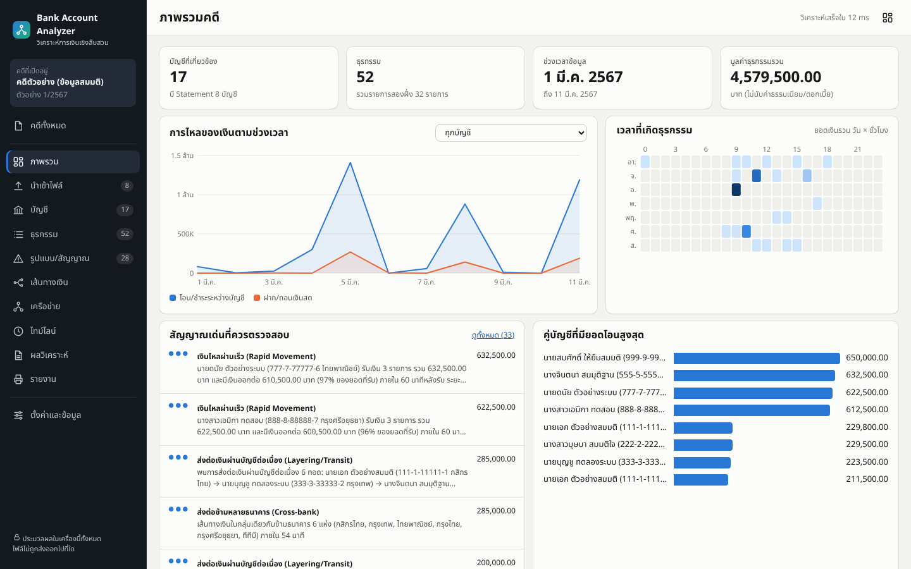
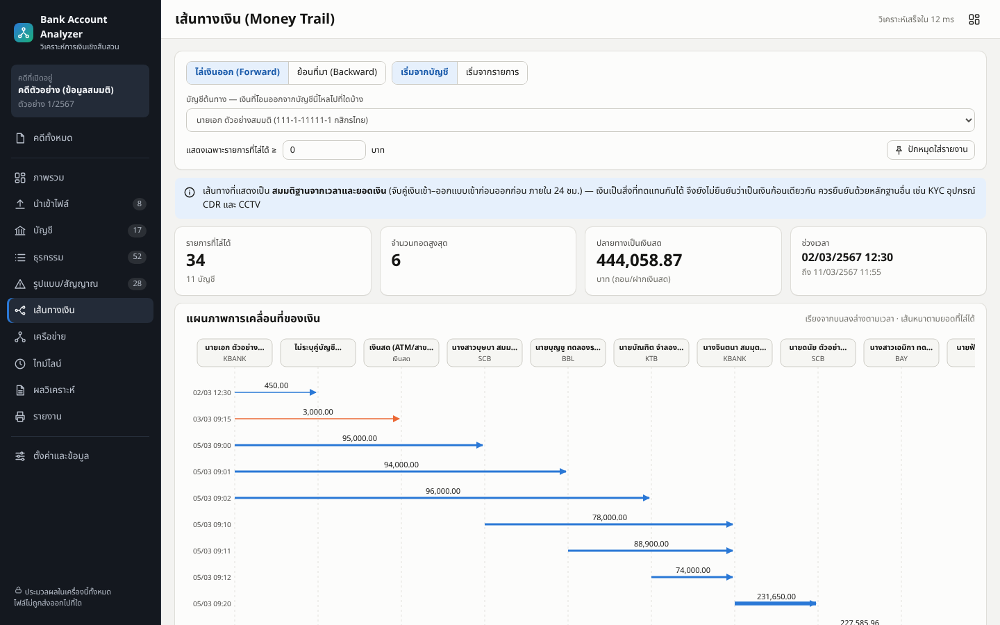
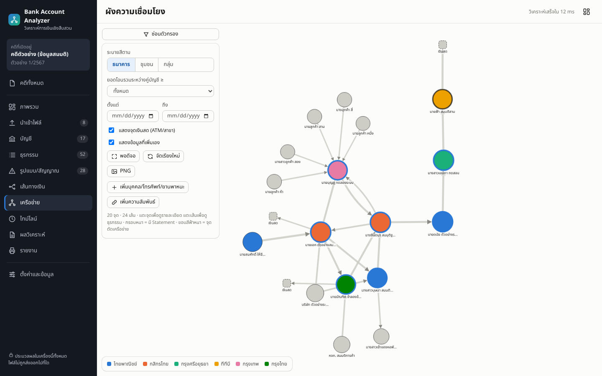

# Bank Account Analyzer — วิเคราะห์การเงินเชิงสืบสวน

เว็บแอปสำหรับงานวิเคราะห์ข้อมูลทางการเงินเชิงสืบสวน: นำเข้า Statement ธนาคาร **หลายบัญชี** → วิเคราะห์ **ความเชื่อมโยงและเส้นทางเงิน** → จัดทำ **รายงานประกอบการสืบสวน** (PDF + Excel)
ออกแบบให้ใช้งานหลักบน **คอมพิวเตอร์** และใช้บน **iPhone** ได้ (ติดตั้งลงหน้าจอโฮมเป็นแอปได้)

> **ข้อมูลทั้งหมดประมวลผลและเก็บในเครื่องของคุณเท่านั้น** — ไม่มีเซิร์ฟเวอร์ ไม่มีการอัปโหลดไฟล์ ไม่เรียกบริการภายนอก (ฟอนต์ ตัวอ่าน PDF และ OCR ภาษาไทยถูกรวมไว้ในแอป ใช้งานออฟไลน์ได้)



## ความสามารถ

| ด้าน | รายละเอียด |
|---|---|
| **นำเข้าหลายบัญชี** | ลากวางหลายไฟล์พร้อมกัน — CSV (UTF‑8 / Windows‑874), Excel `.xlsx` (หลายชีต), PDF ที่เลือกข้อความได้ (รองรับ PDF ที่มีรหัสผ่าน), PDF สแกน/รูปภาพ (OCR ภาษาไทย+อังกฤษในเบราว์เซอร์) · 1 ไฟล์ = 1 บัญชี |
| **อ่านรูปแบบไทย** | วันที่ พ.ศ./ค.ศ. เลขไทย เดือนไทย · ถอน/ฝาก แยกคอลัมน์, คอลัมน์เดียวมีเครื่องหมาย, Dr/Cr, ไฟล์เรียงใหม่→เก่า · เดาคอลัมน์จากหัวตารางไทย/อังกฤษ + หน้าจับคู่คอลัมน์ให้แก้ได้ + จำรูปแบบไว้ใช้ซ้ำ |
| **คุณภาพข้อมูล** | ตรวจยอดคงเหลือต่อเนื่อง, ตัดรายการซ้ำข้ามไฟล์, แสดงแถวที่ถูกข้ามพร้อมเหตุผล, SHA‑256 ของไฟล์ต้นฉบับ, ไฮไลต์ค่า OCR ที่ความมั่นใจต่ำให้แก้ก่อนนำเข้า |
| **เชื่อมหลายบัญชี** | จับคู่รายการที่ปรากฏทั้งสองฝั่ง (A โอนให้ B) นับเป็นรายการเดียว · เลขบัญชีที่ถูกปิดบางส่วน (`xxx-x-x1234-x`) ไม่ถูกรวมเองโดยพลการ — เสนอให้ผู้ใช้ยืนยัน |
| **วิเคราะห์** | โปรไฟล์ต่อบัญชี, Flow‑through, Holding Time (FIFO), Top Sender/Receiver, **Rapid Movement, Structuring/Splitting, Convergence, Layering/Transit, Circular, Cash‑out, Cross‑bank, Repeated, ยอดใต้วงเงิน** (ปรับเกณฑ์ได้) |
| **Money Trail** | ไล่เงินออก (Forward) / ย้อนที่มา (Backward) จากบัญชีหรือรายการ — แผนภาพลำดับตามเวลา + ปลายทาง/ต้นทาง |
| **Network** | ผังเครือข่ายโต้ตอบ (Degree, Betweenness, จุดตัด, ชุมชน), กรองตามยอด/วันที่, เพิ่มบุคคล/โทรศัพท์/ยานพาหนะและความสัมพันธ์จากหลักฐานอื่น, ส่งออก PNG |
| **Timeline** | ธุรกรรม สัญญาณ และเหตุการณ์ที่ผู้สืบสวนบันทึก (ATM/CCTV การจับกุม ข้อมูลภาคสนาม) บนแกนเวลาเดียว |
| **ผลวิเคราะห์ 4 ระดับ** | ระบบร่าง ข้อเท็จจริง / ข้อสังเกต / สมมติฐาน / ข้อเสนอแนะ จากข้อมูลจริง ให้แก้ไขและเลือกใส่รายงาน + คำอธิบายทางเลือกที่ต้องพิจารณา |
| **รายงาน** | **PDF** ภาษาไทย A4 (ปก, บทสรุป, คุณภาพข้อมูล, โปรไฟล์ + กราฟ, คู่บัญชี, Money Trail, ผังเครือข่าย, ไทม์ไลน์, ผลวิเคราะห์, ข้อจำกัด, ภาคผนวกพารามิเตอร์/SHA‑256/ธุรกรรมหลักฐาน) และ **Excel** 8 ชีต |
| **ส่วนตัวและพกพา** | เก็บใน IndexedDB, ส่งออก/นำเข้า “ไฟล์คดี” เข้ารหัส AES‑256‑GCM เพื่อสำรองและย้ายระหว่างคอมพิวเตอร์ ↔ iPhone, ปุ่มลบข้อมูลทั้งหมด |

| Money Trail | ผังเครือข่าย |
|---|---|
|  |  |

## เริ่มใช้งาน

ต้องมี Node.js 20+

```bash
npm install
npm run dev          # http://localhost:5173  (พัฒนา)
npm run build        # สร้างไฟล์สถิตที่ dist/
npm run preview      # ดูผล build ที่ http://localhost:4173
```

`dist/` เป็นไฟล์สถิตล้วน นำไปวางบนเว็บเซิร์ฟเวอร์ใดก็ได้ (Nginx, Apache, GitHub Pages, ไฟล์เซิร์ฟเวอร์ภายในหน่วยงาน) ได้ทันที
> ต้องเปิดผ่าน **HTTPS หรือ `localhost`** เพื่อให้ Service Worker (ออฟไลน์/ติดตั้งแอป) และการเข้ารหัสไฟล์คดีทำงาน — ถ้าเปิดผ่าน `http://` ในเครือข่ายภายใน แอปยังใช้งานได้ แต่จะไม่มีโหมดออฟไลน์

### ใช้บน iPhone
1. เปิด URL ของแอป (HTTPS) ใน Safari → ปุ่มแชร์ → **เพิ่มลงในหน้าจอโฮม**
2. นำเข้าไฟล์จากแอป “ไฟล์” หรือรูปถ่าย Statement · รายงาน PDF: หน้า “รายงาน” → พิมพ์ → ถ่างนิ้วบนภาพตัวอย่าง → แชร์ → บันทึกลงไฟล์
3. ย้ายคดีระหว่างเครื่อง: หน้า “ตั้งค่า” → ส่งออกไฟล์คดี (ตั้งรหัสผ่าน) → AirDrop/ไฟล์ → “คดีทั้งหมด” → นำเข้าไฟล์คดี
4. iOS อาจล้างข้อมูลเว็บที่ไม่ได้เปิดนาน — **ติดตั้งลงหน้าจอโฮมและส่งออกไฟล์คดีสำรองเป็นประจำ** · งานหนัก (OCR หลายสิบหน้า, ผังขนาดใหญ่มาก) แนะนำทำบนคอมพิวเตอร์

## ขั้นตอนการทำงาน

1. **คดีทั้งหมด** → สร้างคดี (หรือกด “ทดลองด้วยข้อมูลสมมติ” เพื่อดูตัวอย่างทั้งหมด)
2. **นำเข้าไฟล์** → ลาก Statement ของแต่ละบัญชี → ตรวจ 4 ขั้น: บัญชีเจ้าของ → จับคู่คอลัมน์ → ตัวอย่างข้อมูล (OCR แก้ได้) → ผลการอ่าน → กด “นำเข้า”
3. **ภาพรวม / บัญชี / ธุรกรรม** → ดูโปรไฟล์ กรอง ค้นหา คัดลอกเป็น TSV (วางใน Excel)
4. **รูปแบบ/สัญญาณ** → ดูรูปแบบที่ควรตรวจ เปิดหลักฐานรายธุรกรรม เพิ่มเข้าผลวิเคราะห์
5. **เส้นทางเงิน / เครือข่าย / ไทม์ไลน์** → ไล่เงิน ดูผัง บันทึกเหตุการณ์และความสัมพันธ์ที่ได้จากหลักฐานอื่น
6. **ผลวิเคราะห์** → ตรวจ/แก้ข้อความ 4 ระดับ ติ๊ก “ใส่ในรายงาน” บันทึกคำอธิบายทางเลือก
7. **รายงาน** → บันทึกเป็น PDF / ส่งออก Excel

คีย์ลัด: `/` โฟกัสช่องค้นหา · `Esc` ปิดแผงรายละเอียด · `Alt+1…9,0` สลับหน้า

## หลักการที่ฝังอยู่ในแอป

อ้างอิงแนวทางการวิเคราะห์เส้นทางการเงินเชิงสืบสวน (Money Trail, Network/Link Analysis, Pattern, Holding Time, Flow‑through):

- **ไม่สรุปความผิดจากธุรกรรมเพียงอย่างเดียว** — ข้อความที่ระบบสร้างใช้ “พบว่า…”, “อาจมีบทบาท…”, “ควรตรวจสอบเพิ่มเติม…” และมีเทสต์ตรวจว่าไม่มีคำชี้ชัดอย่าง “บัญชีม้า/ผู้สั่งการ/เงินค่ายา” หลุดออกไป
- **สัญญาณ = รูปแบบที่ควรตรวจต่อ** ไม่ใช่ข้อพิสูจน์ ความเด่นแสดงเป็นจุด ●●● (ไม่ใช้สีแดง/เหลืองเพื่อไม่สื่อถึงระดับความผิด)
- **คะแนนลำดับการตรวจสอบ** แสดงแยก 7 องค์ประกอบ เป็นค่าสัมพัทธ์ในคดี พร้อมข้อความกำกับว่า “ไม่ใช่คะแนนความผิด”
- **บทบาทของบัญชี** (จุดรวมเงิน, ทางผ่าน, จุดเชื่อม ฯลฯ) แสดงเป็น “อาจมีบทบาท…” พร้อมเหตุผลเชิงข้อมูล · Degree/Betweenness สูง ≠ ความผิด
- **ข้อจำกัดและข้อความปิดท้ายมาตรฐานแนบทุกรายงาน** แก้ไขหรือลบไม่ได้

### เกณฑ์ตั้งต้นของสัญญาณ (ปรับได้ที่หน้า “ตั้งค่า” และแนบในภาคผนวกของรายงานทุกฉบับ)

| รูปแบบ | เกณฑ์ตั้งต้น |
|---|---|
| Rapid Movement | เงินออก ≥ 80% ของที่รับ ภายใน 60 นาที (ยอดรับ ≥ 10,000) |
| Structuring | ≥ 3 รายการ ยอดใกล้กัน ±15% ภายใน 60 นาที ไปอย่างน้อย 2 บัญชี |
| Convergence | ≥ 3 บัญชีโอนเข้าบัญชีเดียวภายใน 120 นาที |
| Layering | ส่งต่อ ≥ 3 ทอด ทอดละ ≤ 120 นาที ยอดเหลือ ≥ 85% |
| Circular | เงินวนกลับบัญชีต้นทางภายใน 72 ชั่วโมง |
| Cash‑out | ถอนเงินสดที่ ≥ 50% ตรงกับเงินโอนเข้าภายใน 120 นาทีก่อนหน้า |
| Repeated | รูปแบบเดิมหรือคู่บัญชี/ยอดเดิมเกิดซ้ำ ≥ 3 วัน |

### วิธีจับคู่เงินเข้า–ออก (สำคัญ)
Holding Time และ Money Trail ใช้การจับคู่ **เข้าก่อนออกก่อน (FIFO)** ต่อบัญชี — เงินเป็นสิ่งที่ทดแทนกันได้ จึงเป็น **สมมติฐาน** ไม่ใช่การยืนยันว่าเป็นเงินก้อนเดียวกัน (ระบุไว้ในหน้าจอ รายงาน และข้อจำกัด) เวลาที่ใช้คือ “เวลาตามที่ปรากฏใน Statement” โดยไม่ขึ้นกับเขตเวลาของเครื่อง ไฟล์ที่ไม่มีเวลาวิเคราะห์ได้ระดับวันและติดธงเตือน

## รูปแบบไฟล์และข้อจำกัดที่ควรรู้

- **ไม่ได้ผูกกับรูปแบบของธนาคารใดโดยเฉพาะ** — ใช้การเดาคอลัมน์จากหัวตารางทั่วไป + หน้าจับคู่คอลัมน์ ทดสอบกับไฟล์สังเคราะห์หลายรูปแบบ (ดูหัวข้อการทดสอบ) ยังไม่ได้ทดสอบกับ Statement จริงของทุกธนาคาร ถ้าไฟล์ของธนาคารใดอ่านไม่ถูก ให้แก้การจับคู่คอลัมน์ในหน้านำเข้า (ระบบจำไว้ให้) หรือส่งตัวอย่างที่ลบข้อมูลส่วนบุคคลแล้วเพื่อเพิ่มรองรับ
- **ไม่รองรับ `.xls` รุ่นเก่า** — บันทึกเป็น `.xlsx` หรือ `.csv` ก่อน
- **คู่บัญชีที่อยู่ในข้อความรายละเอียด** (เช่น “โอนเงินไป กสิกรไทย 123‑4‑56789‑0 นาย ก”) ถูกอ่านแบบเดา ติดธง “อนุมาน” ให้ตรวจกับต้นฉบับ
- **OCR** ภาษาไทยแม่นยำไม่เท่าไฟล์ดิจิทัล (ภาพสังเคราะห์ที่สะอาดอ่านได้ถูกเกือบทั้งหมด — ในชุดทดสอบ 12 แถวพบเพี้ยน 1 จุดที่เวลา และเลขบัญชีคู่โอนอ่านผิดอีก 1 จุด ภาพถ่ายจริงจะคลาดเคลื่อนมากกว่า) จึงมีขั้นตรวจแก้ก่อนนำเข้าเสมอ และระบบ **ไม่เดาค่าที่อ่านไม่ชัด** — แถวที่ระบุวันที่/ยอด/ทิศทางไม่ได้จะถูกข้ามพร้อมเหตุผล · ถ้ารายการสองฝั่งอ่านเลขบัญชีเพี้ยน ระบบจะรวมให้จากยอดและเวลาเฉพาะกรณีที่เป็นคู่เดียวที่เป็นไปได้ และติดธง “จับคู่จากยอดและเวลาเท่านั้น”
- ข้อความที่คัดลอกจาก PDF รายงานอาจมีวรรณยุกต์บางตัวหายเมื่อเปิดด้วยบางโปรแกรม (ภาพพิมพ์และการค้นหาในโปรแกรม PDF ทั่วไปถูกต้อง)

## ความปลอดภัยและความเป็นส่วนตัว

- ไม่มีคำขอเครือข่ายออกนอกเครื่องขณะใช้งาน (ตรวจใน E2E) · CSP จำกัดให้โหลดเฉพาะจาก origin เดียวกัน
- ไฟล์คดีที่ส่งออกเข้ารหัส AES‑256‑GCM คีย์จากรหัสผ่านด้วย PBKDF2‑SHA256 (250,000 รอบ) — ลืมรหัสผ่านกู้คืนไม่ได้
- ข้อมูลอยู่ใน IndexedDB ของเบราว์เซอร์ — เครื่องที่ใช้ร่วมกับผู้อื่นควรลบข้อมูลหลังใช้งาน (หน้า “ตั้งค่า” → ลบข้อมูลทั้งหมด) หรือใช้โปรไฟล์เบราว์เซอร์แยก
- `npm audit` แจ้งช่องโหว่ระดับปานกลางของ `uuid` ผ่าน `exceljs` (กรณีเรียก v3/v5/v6 พร้อม buffer) — แอปไม่ได้ใช้ทางนั้นกับข้อมูลภายนอก แต่ควรติดตามการอัปเดตของ `exceljs`

## การทดสอบ

```bash
npm test                  # Vitest: 101 ข้อ (core, ingest, analysis, store, Excel)
npm run fixtures          # สร้างไฟล์ Statement สังเคราะห์หลายรูปแบบที่ tests/fixtures/generated/ (ต้องมี Chromium)
npm run test:e2e          # Playwright: desktop + iPhone (จำลองด้วย Chromium)
```

- ชุดทดสอบหลักใช้ **ตัวอย่างโครงสร้าง A → B1,B2,B3 → C → D → E → F → ATM** ตรวจว่าพบ Structuring, Convergence, Layering, Cash‑out และไล่เส้นทางไปหน้า/ย้อนกลับได้ถูกต้อง
- `npm run fixtures` สร้างไฟล์ 8 รูปแบบจากสถานการณ์เดียวกัน (CSV พ.ศ., Excel, CSV Windows‑874, PDF ข้อความ, CSV Dr/Cr เรียงย้อน, TSV เลขไทย, PDF สแกน, รูปภาพ) + PDF มีรหัสผ่าน + ไฟล์ 20,000 แถว แล้วทดสอบว่าอ่านกลับได้ตรงต้นทาง และผลวิเคราะห์ตรงกับข้อมูลต้นฉบับ (E2E: 17 บัญชี 52 ธุรกรรม 32 รายการสองฝั่ง)
- ประสิทธิภาพที่วัดได้ (Chromium, เครื่องทดสอบ): นำเข้า+วิเคราะห์ 20,000 แถวราว 2 วินาที, กรองข้อความในตารางราว 0.3 วินาที
- **ข้อจำกัดของการทดสอบ:** ทดสอบด้วย Chromium เท่านั้น ยังไม่ได้ทดสอบบน Safari/iOS จริง — พฤติกรรมเฉพาะ iOS (การเลือกไฟล์, ขั้นตอนบันทึก PDF, การล้างข้อมูลของ Safari, หน่วยความจำขณะ OCR) ควรลองบน iPhone จริง

## โครงสร้างโปรเจกต์

```
src/core/        types, thai (พ.ศ./เลขไทย/จำนวนเงิน), normalize (เลขบัญชี/ธนาคาร/ชื่อ)
src/ingest/      csv, xlsx, pdf (pdf.js), ocr (tesseract.js), tableFromItems, detectColumns, parseRows, consolidate (dedupe + mirror)
src/analysis/    attribution (FIFO), profile, patterns/*, trace, network, roles, priority, findings, worker
src/store/       IndexedDB, ไฟล์คดีเข้ารหัส
src/ui/          หน้าต่าง ๆ, charts (SVG), network (Cytoscape)
src/report/      ReportDocument (A4), staticCharts, exportXlsx
scripts/         copy-assets (ไฟล์ OCR/PDF worker → public/ocr), make-fixtures, make-icons
tests/           unit/, e2e/
```

## สิ่งที่ยังไม่มี

- นำเข้า CDR/Cell Site อัตโนมัติ (ตอนนี้บันทึกเหตุการณ์/ความสัมพันธ์ด้วยมือผ่านหน้าไทม์ไลน์และเครือข่าย)
- เทมเพลตเฉพาะธนาคาร, การทำงานหลายผู้ใช้/ซิงก์ข้ามเครื่อง (ย้ายด้วยไฟล์คดี)
- ปรับขนาดแผงได้ และการบันทึกลงโฟลเดอร์ที่เลือกด้วย File System Access API (ใช้การดาวน์โหลดปกติ)
- PDF ผ่าน `window.print()` (ข้อความไทยคมชัดและเลือกได้) — ยังไม่มีปุ่มดาวน์โหลด PDF โดยตรงในคลิกเดียวบน iOS

> ธุรกรรมทางการเงินและค่าทางเครือข่ายเป็นเครื่องมือช่วยชี้เป้าและสร้างสมมติฐาน ไม่ใช่ข้อพิสูจน์ความผิดหรือความเกี่ยวข้องกับยาเสพติดโดยลำพัง ต้องตรวจสอบร่วมกับ CDR, Cell Site และพยานหลักฐานอื่นที่ได้มาโดยชอบด้วยกฎหมาย
